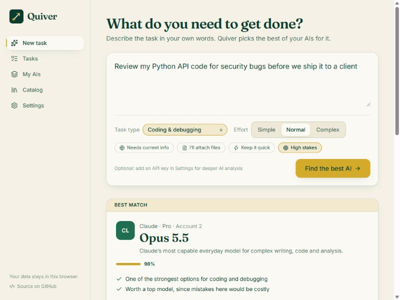

<p align="center">
  
</p>

<h1 align="center">Quiver</h1>

<p align="center"><strong>Pick the right AI from the ones you already pay for.</strong></p>

<p align="center">
  Many of us juggle ChatGPT, Claude, Gemini, Perplexity and more, often with several accounts.<br>
  Quiver looks at each task and tells you which of <em>your</em> AIs to use, with which model, and how to get the best result.
</p>

<p align="center">
  <a href="https://ataxankitord.github.io/quiver/"><strong>Open Quiver →</strong></a>
</p>

<p align="center">
  
</p>

## What it does

- **Knows what you have.** Add your AI subscriptions and plans (free ones too), including several accounts of the same service, such as a work and a personal ChatGPT.
- **Reads the task.** Describe what you need in plain words, in English or Persian. Quiver works out the kind of task (coding, writing, research, images, long documents…), how demanding it is, and whether it needs the web or your files. You can correct anything it got wrong.
- **Recommends an option, not just an app.** It picks the exact model or mode, such as *GPT-6 Thinking*, *Claude Code* or *Gemini Deep Research*, and explains why, with two alternatives.
- **Saves your limits.** Light tasks go to light models so the heavy ones are there when you need them. Mark an account as "hit a limit" and Quiver routes around it until the limit resets. Work is spread across accounts you use a lot.
- **Helps you get a better result.** Every recommendation comes with a structured prompt to copy, plus tips for that model and that kind of task.
- **Keeps track.** Every task lands on a simple board (to do, in progress, done). Rate the result and Quiver learns which AIs work best for you.
- **Optional AI assist.** Add your own Claude API key for a deeper reading of each task and a rewritten prompt. Without a key, everything runs on built-in rules, offline and free.

## Privacy

Quiver has no server and no accounts. Your AIs, tasks and settings are stored in your browser's local storage. If you add an API key, it stays in your browser and is sent only to `api.anthropic.com`; it is never included in exports. Use **Settings → Export backup** to move your data to another device.

## Supported AIs

ChatGPT, Claude, Gemini, Grok, Perplexity, Microsoft Copilot, DeepSeek, Mistral Le Chat, GitHub Copilot and Midjourney, each with its plans and the models and modes each plan includes. You can also add any other AI by hand and say what it is good at.

The catalog lives in [`src/lib/catalog.ts`](src/lib/catalog.ts). Plans and model names were checked against each provider's official pages on **11 November 2026**. AI products change fast, so corrections are very welcome (see [Contributing](#contributing)).

## How the recommendation works

1. **Analyse.** [`analyzer.ts`](src/lib/analyzer.ts) matches the task against English and Persian keywords for 16 task types and detects needs such as current information, files, speed and high stakes, plus an effort level.
2. **Score.** [`recommender.ts`](src/lib/recommender.ts) scores every model and mode your plans include. The score starts from the option's fit for the task types (0–10 in the catalog) and is adjusted for:
   - effort: heavy models for complex work, light ones for simple questions;
   - speed, web access and file support when the task needs them;
   - how much headroom your plan has;
   - how often you used that account in the last five hours;
   - your own ratings of similar tasks.
3. **Explain.** The top option and two alternatives (preferring other providers) are shown with reasons, tips and a ready-to-edit prompt from [`prompt.ts`](src/lib/prompt.ts).

With AI assist on, Claude reads the task, ranks your options and writes the prompt. Quiver validates that answer and still applies your manual corrections and its own scoring on top.

## Run it locally

You need [Node.js](https://nodejs.org/) 22 or newer.

```bash
git clone https://github.com/AtaxanKitord/quiver.git
cd quiver
npm install
npm run dev
```

| Command | What it does |
|---|---|
| `npm run dev` | Start the dev server |
| `npm test` | Run the tests |
| `npm run build` | Type-check and build into `dist/` |
| `npm run preview` | Serve the production build |

The build is a static site that works on any host. Pushing to `main` deploys it to GitHub Pages through [`.github/workflows/deploy.yml`](.github/workflows/deploy.yml).

**Built with** React, TypeScript, Vite, Tailwind CSS, Zustand and the Anthropic SDK.

## Contributing

The most useful contributions are updates to the catalog: a new plan, a renamed model, a feature that moved between plans, or a score you disagree with. Edit [`src/lib/catalog.ts`](src/lib/catalog.ts), add the official source link, run `npm test`, and open a pull request. Bug reports and ideas are welcome as issues.

## Disclaimer

Quiver is an independent project and is not affiliated with OpenAI, Anthropic, Google, xAI, Perplexity, Microsoft, DeepSeek, Mistral AI, GitHub or Midjourney. Product names are trademarks of their owners. Scores are editorial opinions, not benchmarks. Always check a provider's own page before buying a plan.

## License

[MIT](LICENSE) © AtaXan
